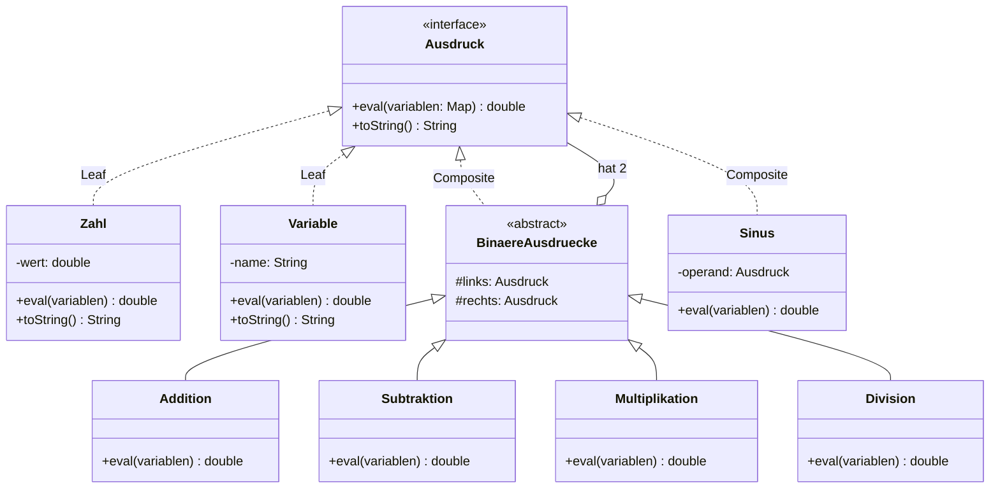

# 📐 Mathematische Ausdrücke (Composite Pattern in Java)

Eine objektorientierte Implementierung zur Modellierung, Repräsentation und rekursiven Auswertung mathematischer Ausdrücke auf Basis des **Composite Patterns (Kompositum)** aus der *Gang of Four (GoF)*.

Entwickelt im Rahmen des Gegenstands **Softwareentwicklung (SEW)** an der HTL TGM Wien (4. Jahrgang, 1. Semester).

---

## 🏛 Architektur & Entwurfsmuster (Composite Pattern)

Das **Composite Pattern** erlaubt es, komplexe mathematische Syntaxbäume aus einfachen Blättern (*Leaves*, z. B. Zahlen oder Variablen) und zusammengesetzten Operationen (*Composites*, z. B. Addition, Multiplikation, trigonometrische Funktionen) einheitlich über das gemeinsame Interface `Ausdruck` zu behandeln.



---

## ✨ Features

- **Rekursive Baumauswertung (`eval`)**:
  - Jeder Teilausdruck berechnet seinen eigenen Wert rekursiv.
  - Dynamische Variablenbelegung via Key-Value-Mapping (`Map<String, Double>`).
- **Umfangreicher mathematischer Operator-Support**:
  - **Grundrechenarten:** `Addition`, `Subtraktion`, `Multiplikation`, `Division`
  - **Arithmetik & Potenzen:** `Potenzieren`, `Negieren`
  - **Extremwerte:** `Minimum`, `Maximum` (aus beliebigen Teilausdrücken)
  - **Trigonometrie:** `Sinus`, `Cosinus`, `Tangens`
- **Typisierte Blätter (*Leaves*)**:
  - `Zahl`: Feste Gleitkommawerte.
  - `Variable`: Dynamische Platzhalter (z. B. $x$, $y$), die zur Laufzeit belegt werden.
- **Vollständige Testabdeckung**:
  - JUnit 5 Testsuite für Randfälle, Division durch Null und komplexe verschachtelte Terme.
- **UML-Dokumentation**:
  - Vollständiges Astah UML-Klassendiagramm (`UML-Diagramm_CompositePattern.asta`).

---

## 💻 Code-Beispiel

```java
// Beispiel: (5 + x) * sin(y)
Ausdruck fünf = new Zahl(5);
Ausdruck x = new Variable("x");
Ausdruck summe = new Addition(fünf, x);

Ausdruck y = new Variable("y");
Ausdruck sinY = new Sinus(y);

Ausdruck gesamterTerm = new Multiplikation(summe, sinY);

// Variablenwerte festlegen
Map<String, Double> belegung = new HashMap<>();
belegung.put("x", 3.0);
belegung.put("y", Math.PI / 2); // 90 Grad

// Rekursive Auswertung
double ergebnis = gesamterTerm.eval(belegung);
System.out.println(gesamterTerm + " = " + ergebnis);
// Ausgabe: ((5.0 + x) * sin(y)) = 8.0
```

---

## 📁 Projektstruktur

```
composite-pattern-expressions/
├── README.md                           # Projektdokumentation
├── JUnitTests/                         # Automatisierte Testfälle
│   └── Tests.java                      # JUnit 5 Tests für alle Operationen
└── src/                                # Quellcode
    ├── Ausdruck.java                   # Zentrales Component-Interface
    ├── Zahl.java                       # Leaf: Feste Zahlen
    ├── Variable.java                   # Leaf: Dynamische Variablen
    ├── BinaereAusdruecke.java          # Abstrakte Basisklasse für 2 Operanden
    ├── Addition.java                   # Composite: Addition
    ├── Subtraktion.java                # Composite: Subtraktion
    ├── Multiplikation.java             # Composite: Multiplikation
    ├── Division.java                   # Composite: Division
    ├── Potenzieren.java                # Composite: Exponenten
    ├── Negieren.java                   # Composite: Vorzeichenwechsel
    ├── Minimum.java / Maximum.java     # Composite: Min/Max Funktionen
    ├── Sinus.java / Cosinus.java ...   # Composite: Trigonometrische Funktionen
    └── UML-Diagramm_CompositePattern.asta # Astah UML-Modell
```

---

## 🚀 Ausführung & Tests

### Kompilieren
```bash
javac -d out/production/src src/*.java
```

### Tests ausführen
Die Testfälle in `JUnitTests/Tests.java` können direkt in IntelliJ IDEA, Eclipse oder per JUnit Runner ausgeführt werden.

---

## 👤 Autor

**Timon Hollaus**  
HTL TGM Wien – Abteilung für Informationstechnologie
